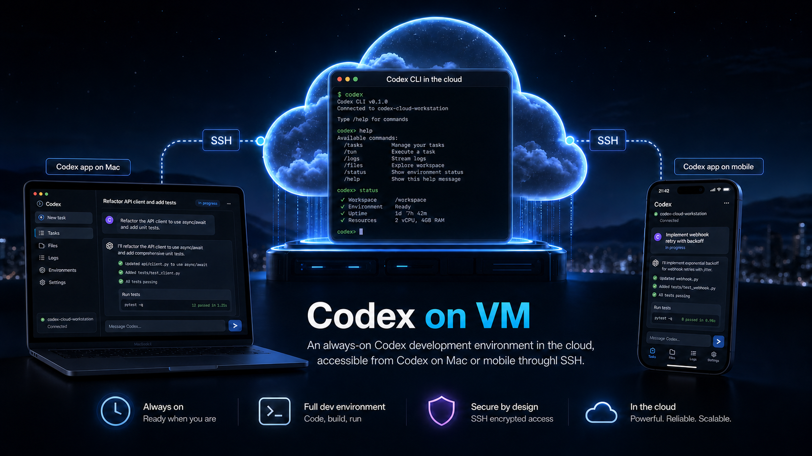

# Codex on a VM

Run Codex on an always-available Ubuntu 24.04 VM in Azure and control it from the Codex app on your Mac. Terraform creates the VM, a 256 GiB persistent workspace at `/home/azureadmin/projects`, and daily backups with 30-day retention and deletion protection.

Your repositories, Codex account, sessions, and tools stay on the persistent disk, so the Mac can sleep and the VM can be replaced without losing the workspace. Remote Control is the normal access path; SSH stays closed unless `scripts/codex-vm.sh` opens temporary `/32` access for maintenance or a Mac workspace mount.

## Quick start

You need Terraform 1.14+, Azure CLI, and an Azure subscription. Azure resources create ongoing costs.

From the repository root:

```bash
az login

cp deployment/prod/tf/terraform.tfvars.example \
  deployment/prod/tf/terraform.tfvars
cp deployment/prod/tf/backend.hcl.example \
  deployment/prod/tf/backend.hcl
```

Fill in the placeholders in both copied files, then create the infrastructure:

```bash
cd deployment/prod/tf

terraform init -reconfigure -backend-config=backend.hcl
terraform plan -out=tfplan
terraform apply tfplan

cd ../../..
```

Set up Codex, sign in, and pair your Mac:

```bash
scripts/codex-vm.sh setup
scripts/codex-vm.sh sign-in
scripts/codex-vm.sh pair
```

Enter the pairing code in the Codex app while using the same ChatGPT account. After pairing, Remote Control is the normal way to use the VM.

## Manage or repair the VM

After pairing, use Codex through the Mac app. You only need the operator console to inspect, change, or repair the VM.

Open the interactive console:

```bash
scripts/codex-vm.sh
```

Or run a workflow directly:

| Task | Command |
| --- | --- |
| Check VM and access state | `scripts/codex-vm.sh status` |
| Set up or repair Codex | `scripts/codex-vm.sh setup` |
| Sign in to Codex | `scripts/codex-vm.sh sign-in` |
| Pair another device | `scripts/codex-vm.sh pair` |
| Clone or update dot-codex | `scripts/codex-vm.sh dot-codex` |
| Open a temporary SSH shell | `scripts/codex-vm.sh shell` |
| Mount projects on the Mac | `scripts/codex-vm.sh workspace-open` |
| Unmount projects and close SSH | `scripts/codex-vm.sh workspace-close` |
| Close SSH left by an interrupted operation | `scripts/codex-vm.sh ssh-close` |

If Codex or Remote Control stops working, run:

```bash
scripts/codex-vm.sh setup
```

Setup is idempotent, does not open SSH, and preserves the persistent Codex home. Run it again after replacing the VM.

## Persistence and access

Keep repositories under `/home/azureadmin/projects`. The workspace and Codex home are on the managed data disk; files elsewhere on the VM may be lost during replacement.

There is no permanent inbound SSH rule. Shell and workspace commands open restricted access for the current Mac IP and close it when finished.

Never commit Terraform state, `terraform.tfvars`, `backend.hcl`, private keys, pairing codes, or credentials.

## More detail

- [Operations guide](docs/OPERATIONS.md): deployment, recovery, SSHFS, command behavior, and current follow-up work.
- [Architecture](docs/ARCHITECTURE.md): infrastructure ownership, storage, security, and failure boundaries.
- [Operator console contract](docs/features/codex-vm-operator-console/FEATURE.md).
- [Remote Control and workspace contract](docs/features/remote-control-managed-workspace/FEATURE.md).
- [dot-codex bootstrap contract](docs/features/dot-codex-vm-bootstrap/FEATURE.md).
